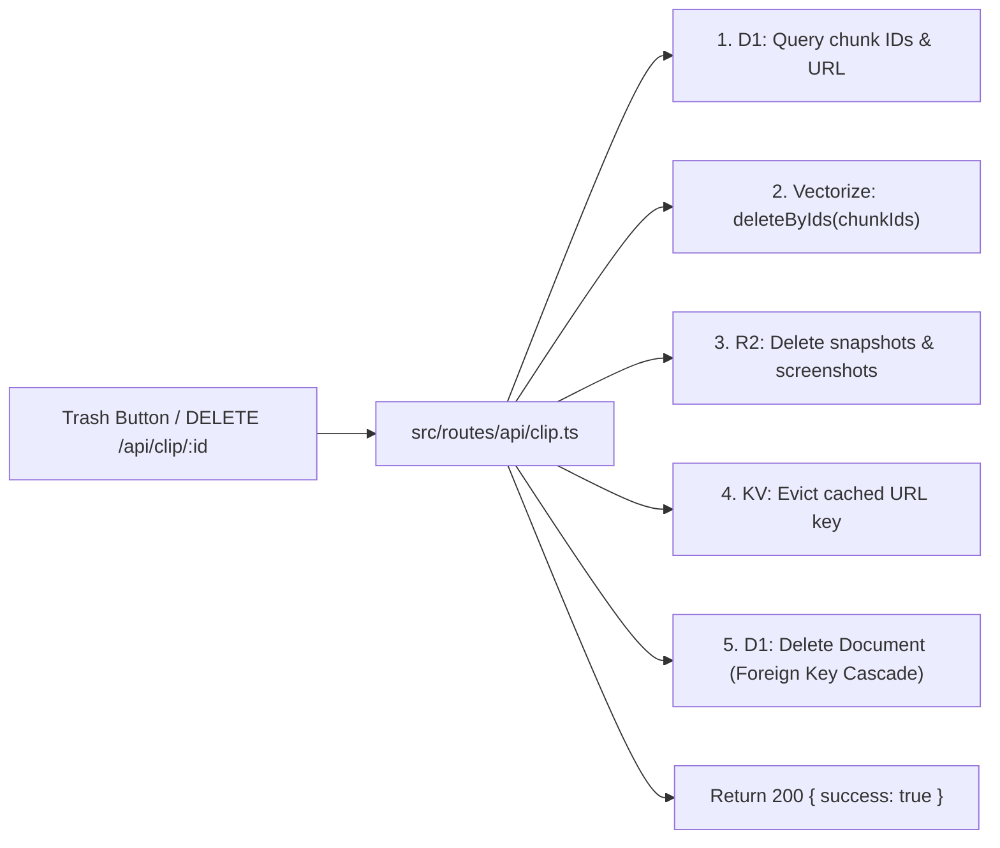

# ClipMind

<div align="center">


# ClipMind
### Cloudflare-Native Edge Web Clipper, Semantic Knowledge Vault & RAG Agent

[](https://www.typescriptlang.org/)
[](https://workers.cloudflare.com/)
[](https://hono.dev/)
[](https://developers.cloudflare.com/d1/)
[](https://developers.cloudflare.com/vectorize/)
[](https://developers.cloudflare.com/r2/)
[-brightgreen?style=flat-square)](#cloudflare-free-tier-safeguards)
[](#automated-testing)

**ClipMind** is a serverless, privacy-preserving web clipper, durable document archiver, and edge-native semantic retrieval engine built **100% on Cloudflare Free Tier primitives**. It operates with **zero external SDK dependencies**—no OpenAI, Anthropic, LangChain, Pinecone, or AWS S3 clients.

</div>

---

## Table of Contents

- [Key Highlights](#key-highlights)
- [System Architecture & Topology](#system-architecture--topology)
- [Cloudflare Free-Tier Safeguards](#cloudflare-free-tier-safeguards)
- [Core Ingestion Pipeline (4 Stages)](#core-ingestion-pipeline-4-stages)
- [TypeSafe JEV-1.14.0 Evaluation & Guardrails](#typesafe-jev-1140-evaluation--guardrails)
- [Extractive Edge RAG & Hallucination Prevention](#extractive-edge-rag--hallucination-prevention)
- [Multi-Service Cascade Deletion Engine](#multi-service-cascade-deletion-engine)
- [Interactive Dashboard & Markdown Renderer](#interactive-dashboard--markdown-renderer)
- [Discord Ingestion Bot (Domainless Webhook)](#discord-ingestion-bot-domainless-webhook)
- [Directory Structure](#directory-structure)
- [Local Development & Setup](#local-development--setup)
- [Database Migrations](#database-migrations)
- [Production Deployment](#production-deployment)
- [REST & WebSocket API Reference](#rest--websocket-api-reference)
- [Automated Testing](#automated-testing)
- [License](#license)

---

## Key Highlights

- **Edge SSR UI + Live WebSockets**: Server-rendered interactive dashboard via [Hono](https://hono.dev), featuring real-time ingestion status indicators, streaming search, rendered Markdown responses, raw archive previews, and one-click deletion.
- **Zero-Cost WebSocket Hibernation**: Durable Objects (`ProgressRoomDO`) utilizing the WebSocket Hibernation API (`this.ctx.acceptWebSocket`), consuming **0 GB-s CPU** while idle waiting for events.
- **Durable 4-Stage Workflow**: Cloudflare Workflows (`ClipPipelineWorkflow`) orchestrating headless scraping, vectorization, and structured validation decoupled from HTTP timeouts.
- **Headless Chrome DOM Sanitization**: Headless rendering via Cloudflare Browser Rendering (`@cloudflare/puppeteer`), stripping navigation noise, ads, footers, and tracking scripts while explicitly extracting structured metadata and Wikipedia infobox tables (`<table class="infobox">`).
- **Native Dual AI Pipeline**:
  - **Dense Embeddings**: `@cf/baai/bge-small-en-v1.5` generating 384-dimensional dense vectors.
  - **Evaluation & Guardrails**: `@cf/typesafe/jev-1.14.0` (with fallback to `typesafe/jev-1.14.0` and heuristic rules) enforcing quality gates, synthetic tags, and citation alignment checks.
  - **Extractive Edge RAG**: `@cf/meta/llama-3.2-3b-instruct` operating with strict temperature = 0.0 closed-book prompting and citation attribution.
- **Cloudflare Vectorize + D1**: Sub-second cosine similarity search on Vectorize paired with relational document tracking, chunk offsets, and cascading referential integrity on D1.
- **Full Data Purge Support**: Unified single-click deletion purging across D1, Vectorize (`deleteByIds`), R2 snapshots, and KV cache simultaneously.
- **Domainless Discord Ingestion**: Zero-server Discord bot verifying Ed25519 signatures with TweetNaCl at the edge.

---

## System Architecture & Topology

```mermaid
flowchart TD
    subgraph ClientLayer["Clients & Triggers"]
        BrowserUI["Web Dashboard / Bookmarklet"]
        DiscordBot["Discord Client (/clip)"]
        WebSocketClient["WebSocket Status Listener"]
    end

    subgraph EdgeRouting["Hono Edge Router (Cloudflare Worker)"]
        HonoApp["Hono HTTP Entrypoint (src/index.ts)"]
        ClipRoute["POST /api/clip"]
        SearchRoute["POST /api/search"]
        DeleteRoute["DELETE /api/clip/:id"]
        DiscordRoute["POST /api/discord (TweetNaCl Ed25519)"]
        WSRoute["GET /ws (DO Upgrade)"]
    end

    subgraph DurableCoordination["Coordination & Hibernation"]
        DOWebSocket["Durable Object: ProgressRoomDO (Hibernated WebSocket)"]
        Workflows["Cloudflare Workflows: ClipPipelineWorkflow (4 Stages)"]
    end

    subgraph HeadlessBrowser["Cloudflare Browser Rendering"]
        Puppeteer["@cloudflare/puppeteer (Headless Chromium)"]
    end

    subgraph StorageLayer["Edge Persistence & Cache"]
        D1["Cloudflare D1 (SQLite SQL: documents, chunks)"]
        R2["Cloudflare R2 (clipmind-vault: Markdown, WebP Screenshots)"]
        KV["Cloudflare KV (URL Cache & Dedup)"]
        Vectorize["Cloudflare Vectorize (clipmind-embeddings: 384-dim, Cosine)"]
    end

    subgraph EdgeAI["Cloudflare Workers AI"]
        EmbedModel["@cf/baai/bge-small-en-v1.5 (Embeddings)"]
        JevModel["@cf/typesafe/jev-1.14.0 (Document & RAG Guardrails)"]
        LlamaModel["@cf/meta/llama-3.2-3b-instruct (RAG Generation)"]
    end

    %% Client flows
    BrowserUI -->|HTTP POST / GET| HonoApp
    DiscordBot -->|Webhook Payload| DiscordRoute
    BrowserUI -.->|WS Connection| WSRoute
    WSRoute --> DOWebSocket

    %% Edge dispatch
    ClipRoute -->|Trigger Ingestion| Workflows
    DiscordRoute -->|Dispatch /clip| Workflows
    ClipRoute -->|Check Dedup| KV
    SearchRoute -->|Embed Query| EmbedModel
    SearchRoute -->|Vector Match| Vectorize
    SearchRoute -->|Fetch Chunks| D1
    SearchRoute -->|Closed-Book RAG| LlamaModel
    SearchRoute -->|Self-Correction Audit| JevModel
    DeleteRoute -->|Purge SQL| D1
    DeleteRoute -->|Purge Vectors| Vectorize
    DeleteRoute -->|Delete Blobs| R2
    DeleteRoute -->|Evict Cache| KV

    %% Workflow stages
    Workflows -->|Stage 1: Render DOM & Screenshot| Puppeteer
    Puppeteer -->|Store Screenshot & MD| R2
    Workflows -->|Stage 2: Evaluate Quality & Tags| JevModel
    Workflows -->|Stage 3: Sliding Chunker & Embed| EmbedModel
    Workflows -->|Stage 4: Upsert Vectors & Records| Vectorize
    Workflows -->|Stage 4: Write Document & Chunks| D1
    Workflows -.->|Broadcast Progress 0-100%| DOWebSocket
    DOWebSocket -.->|Push JSON Status| WebSocketClient
```



---

## Cloudflare Free-Tier Safeguards

ClipMind is architected to operate comfortably within the monthly and daily limits of Cloudflare's standard Free Tier:

| Service | Free Tier Allocation | ClipMind Usage & Optimizations |
| :--- | :--- | :--- |
| **Workers** | 100,000 req/day | Hono SSR + edge caching; minimal overhead. |
| **Workflows** | Included on Workers Free | Asynchronous execution offloading compute from HTTP requests. |
| **Durable Objects** | Free allocation (Hibernation) | WebSockets use `this.ctx.acceptWebSocket`; **0 GB-s CPU** while clients are connected idle. |
| **Browser Rendering** | Free beta tier | Concurrency-limited sessions; KV cache prevents re-scraping the same URL within 24 hours. |
| **Cloudflare D1** | 5M read rows/day, 100k write rows/day | Indexed queries (`url`, `status`, `document_id`); optimized batch inserts. |
| **Cloudflare R2** | 10 GB storage, 1M Class A, 10M Class B ops/mo | Highly compressed WebP screenshots + raw Markdown snapshots. |
| **Cloudflare Vectorize** | 30,000 vectors stored, 30M queried/mo | 384-dimensional embeddings (`bge-small-en-v1.5`), sliding window deduplication. |
| **Workers AI** | 10,000 Neurons/day free | Strict prompt length budgets, `temperature: 0.0`, and lightweight structured models. |

---

## Core Ingestion Pipeline (4 Stages)

When a URL is submitted via the Dashboard, Bookmarklet, or Discord, Cloudflare Workflows executes `ClipPipelineWorkflow`:

```
┌────────────────────────────────────────────────────────────────────────┐
│                      Cloudflare Workflow Stages                        │
└────────────────────────────────────────────────────────────────────────┘

[Stage 1: Headless Capture & Infobox Preservation]
  │  • Cloudflare Browser Rendering (@cloudflare/puppeteer)
  │  • Strips <nav>, <header>, <footer>, <script>, <style>, .ad, #mw-navigation
  │  • Preserves tables, Wikipedia <table class="infobox"> -> converted to "## Quick Facts"
  │  • Generates 1280x720 WebP screenshot and clean Markdown text
  │  • Writes assets directly to Cloudflare R2 (snapshots/{id}.md, screenshots/{id}.webp)
  ▼
[Stage 2: Structured JEV Evaluation & Semantic Tagging]
  │  • Invokes @cf/typesafe/jev-1.14.0 (Structured Evaluation Model)
  │  • Computes: quality_score (0.0-1.0), content_type, summary, tags, is_paywalled
  │  • If quality_score < 0.25: Document marked as 'rejected_by_jev' (prevents poisoning)
  │  • If valid: Updates D1 with tags, summary, and JEV evaluation metadata
  ▼
[Stage 3: Sliding-Window Semantic Chunking]
  │  • Word-boundary sliding window: 400 words per chunk with 40-word overlap
  │  • Preserves heading context and metadata across chunk seams
  │  • Embeds each chunk into 384 dimensions using @cf/baai/bge-small-en-v1.5
  ▼
[Stage 4: Vector Indexing & Relational Persistence]
  │  • Batch upserts vectors and metadata into Cloudflare Vectorize (clipmind-embeddings)
  │  • Inserts document record and chunk mappings into Cloudflare D1 (clipmind-db)
  │  • Caches URL in KV namespace to prevent duplicate scraping within 24 hours
  │  • Emits completed event via WebSocket Hibernation (ProgressRoomDO)
```

---

## TypeSafe JEV-1.14.0 Evaluation & Guardrails

ClipMind features a dedicated evaluation and validation service (`src/services/jev.ts`) using Cloudflare's native `@cf/typesafe/jev-1.14.0` (with automatic fallback to `typesafe/jev-1.14.0` and heuristic fallbacks).

### 1. Document Ingestion Evaluation
Before any web page is chunked or vectorized, it must pass JEV evaluation:
- **Quality Score**: Assesses signal-to-noise ratio, completeness, and substance.
- **Paywall / Block Detection**: Identifies Cloudflare challenge screens, bot blocks, login gates, and 404 pages.
- **Automated Categorization**: Extracts top topics, content type (`article`, `documentation`, `research`, etc.), and a concise executive summary.
- **Poisoning Prevention**: Pages scoring below `0.25` are flagged as `rejected_by_jev` in D1 and excluded from vector indexing.

### 2. RAG Hallucination & Citation Verification
When queries are answered, JEV audits the synthesized output against the retrieved source chunks:
- **Hallucination Scoring**: Flags unsupported claims (`has_hallucinations: true`).
- **Citation Precision**: Verifies whether cited chunk numbers (`[1]`, `[2]`) genuinely contain the stated facts.
- **Self-Correction Trigger**: If hallucination is detected, the pipeline automatically strips hallucinated statements or prompts for a strict extractive fallback.

---

## Extractive Edge RAG & Hallucination Prevention

ClipMind's retrieval engine (`POST /api/search`) was engineered specifically to eliminate citation hallucinations:

1. **Jaccard Chunk Deduplication**: Retrieved chunks are compared against each other; if two chunks share $>80\%$ similarity (e.g. repeated boilerplate or overlapping segments), the redundant chunk is discarded.
2. **XML Context Segregation**:
   ```xml
   <retrieved_context>
     <source id="1" title="Document Title" url="...">
       Extracted text content...
     </source>
   </retrieved_context>
   ```
3. **Closed-Book Extractive Prompting**:
   - `temperature: 0.0` to eliminate creative drift.
   - Strict instructions: *"You are a strict, closed-book information extraction assistant. Answer ONLY using facts directly stated in <retrieved_context>. If the context does not explicitly contain the answer, state that the context lacks this information. NEVER fabricate authors, dates, or specifications."*
4. **Post-Synthesis JEV Audit**: Before returning to the UI or API caller, JEV inspects the answer and returns an audit object containing `groundedness_score`, `hallucination_detected`, and `verdict`.

---

## Multi-Service Cascade Deletion Engine

Deleting a document in ClipMind does not just mark a row as deleted—it executes a complete distributed purge across four Cloudflare edge services:



1. **Cloudflare D1**: Retrieves all vector chunk IDs associated with the document.
2. **Cloudflare Vectorize**: Calls `env.VECTORIZE.deleteByIds(chunkIds)` to remove vectors from the index.
3. **Cloudflare R2**: Purges `snapshots/{id}.md` and `screenshots/{id}.webp`.
4. **Cloudflare KV**: Evicts `clip:{url}` to allow the URL to be re-clipped in the future if desired.
5. **Cloudflare D1 (Cascade)**: Deletes the document row from `documents`, triggering automatic cascade deletion of corresponding rows in `chunks`.

---

## Interactive Dashboard & Markdown Renderer

ClipMind provides an edge server-rendered UI powered by Hono JSX and CSS styling:

- **Ingestion Modal & Bar**: Input any URL or use the 1-click JavaScript Bookmarklet. Real-time progress bar streams from `0% -> 25% (Scraping) -> 50% (Evaluating) -> 75% (Chunking) -> 100% (Indexed)`.
- **Indexed Knowledge Vault**: Card view of all clipped documents displaying page title, domain, screenshot thumbnail, JEV quality score, extracted tags, and one-click actions:
  - 📖 **View Markdown**: Direct raw stream from R2.
  - 🖼️ **View Screenshot**: Direct WebP image view from R2.
  - 🗑️ **Delete Clip**: Instant multi-service purge with confirmation.
- **Clean Chat & RAG Console**: Interactive conversational interface that renders:
  - Formatted Markdown with code syntax blocks.
  - Interactive clickable citation tags (`[1]`, `[2]`).
  - Source attribution inspector showing exact chunk text and match similarity.
  - JEV Quality & Hallucination Guardrail badges.

---

## Discord Ingestion Bot (Domainless Webhook)

ClipMind includes a domainless Discord Interactions webhook (`POST /api/discord`):

1. **Edge Cryptography**: Cryptographically validates Discord's `X-Signature-Ed25519` and `X-Signature-Timestamp` headers using TweetNaCl (`tweetnacl`) at zero cold-start overhead.
2. **Zero-Latency Handshake**: Automatically responds to Discord `PING` heartbeats with `PONG` (Type 1).
3. **Slash Command Execution**: Responds to `/clip <url>` with an immediate deferred response (`type: 5`), launches the Cloudflare Workflow asynchronously, and follows up with an embedded status card once indexed.

---

## Directory Structure

```
ClipMind/
├── wrangler.jsonc                  # Cloudflare bindings: D1, R2, Vectorize, KV, AI, Browser, Workflows, DO
├── package.json                    # Scripts and pnpm dependencies
├── pnpm-lock.yaml                  # Deterministic dependency lockfile
├── tsconfig.json                   # Strict TypeScript compiler configuration
├── vitest.config.ts                # Vitest configuration with Workers mock resolver
├── schema.sql                      # Cumulative SQL schema definition
├── migrations/
│   ├── 0001_init.sql               # Base schema: documents and chunks tables
│   └── 0002_add_jev_evaluation.sql   # Migration: JEV evaluation columns & check constraints
├── src/
│   ├── index.ts                    # Hono application root, DO & Workflow binding exports
│   ├── routes/
│   │   ├── index.tsx               # Server-rendered Vault Dashboard, Chat UI & Bookmarklet
│   │   ├── ws.ts                   # WebSocket upgrade route forwarding to DO
│   │   └── api/
│   │       ├── clip.ts             # Ingestion API (POST), List (GET), and Cascade Delete (DELETE)
│   │       ├── discord.ts          # Discord Ed25519 webhook & /clip handler
│   │       ├── search.ts           # Closed-book Edge RAG query & JEV hallucination audit
│   │       └── raw.ts              # R2 asset streaming (Markdown snapshots & WebP screenshots)
│   ├── workflows/
│   │   └── clip-pipeline.ts        # 4-stage durable ingestion workflow
│   ├── durable-objects/
│   │   └── progress-room.ts        # WebSocket Hibernation broadcast hub
│   ├── services/
│   │   └── jev.ts                  # TypeSafe @cf/typesafe/jev-1.14.0 evaluation service
│   └── lib/
│       ├── chunker.ts              # 400-word sliding window chunker
│       └── discord-verify.ts       # Ed25519 signature validator (TweetNaCl)
└── tests/
    ├── chunker.test.ts             # Chunker unit tests
    ├── discord-verify.test.ts      # Discord Ed25519 verification tests
    ├── jev.test.ts                 # JEV service evaluation & fallback tests
    ├── routes.test.ts              # Hono REST endpoints & cascade delete tests
    └── mocks/
        └── cloudflare-workers.ts   # Vitest mock for cloudflare:workers runtime
```

---

## Local Development & Setup

### Prerequisites

- [Node.js](https://nodejs.org/) (v20.x or later)
- [pnpm](https://pnpm.io/) (`corepack enable && corepack prepare pnpm@latest --activate`)
- A [Cloudflare Account](https://dash.cloudflare.com/) (Free Tier is sufficient)

### 1. Clone & Install Dependencies

```bash
git clone https://github.com/your-username/ClipMind.git
cd ClipMind
pnpm install
```

### 2. Configure Environment Variables

ClipMind uses `wrangler.jsonc`. To configure your local environment, copy or review `wrangler.jsonc`.

### 3. Run Local Database Migrations

Apply the database schema locally to the local D1 instance:

```bash
pnpm db:migrate:local
```

### 4. Run the Automated Test Suite

Run all 22 Vitest unit and integration tests:

```bash
pnpm test
```

### 5. Start Local Development Server

```bash
pnpm dev
```

The application will be running locally at `http://localhost:8787`.

---

## Database Migrations

ClipMind uses SQL migrations located in `migrations/`:

### Migration Files
1. `0001_init.sql`: Creates initial `documents` and `chunks` tables with index strategies.
2. `0002_add_jev_evaluation.sql`: Safely migrates schema to add JEV evaluation columns (`quality_score`, `content_type`, `summary`, `tags`, `is_paywalled`, `jev_evaluated_at`) and adds `'rejected_by_jev'` to the status constraint without losing existing indexed knowledge.

### Executing Migrations

**Local Environment:**
```bash
pnpm wrangler d1 execute clipmind-db --local --file=./migrations/0001_init.sql
pnpm wrangler d1 execute clipmind-db --local --file=./migrations/0002_add_jev_evaluation.sql
```

**Remote Cloudflare Production:**
```bash
pnpm wrangler d1 execute clipmind-db --remote --file=./migrations/0001_init.sql
pnpm wrangler d1 execute clipmind-db --remote --file=./migrations/0002_add_jev_evaluation.sql
```

*(When prompted `Ok to proceed? › (Y/n)`, press `Y`)*.

---

## Production Deployment

### 1. Create Cloudflare Resources

Run the following commands using `pnpm wrangler`:

```bash
# 1. Create D1 SQLite Database
pnpm wrangler d1 create clipmind-db

# 2. Create R2 Storage Bucket
pnpm wrangler r2 bucket create clipmind-vault

# 3. Create Vectorize Index (384 dimensions, Cosine metric)
pnpm wrangler vectorize create clipmind-embeddings --dimensions=384 --metric=cosine

# 4. Create KV Namespace for URL Deduplication
pnpm wrangler kv:namespace create KV
```

### 2. Update `wrangler.jsonc`

Update `wrangler.jsonc` with the database ID and KV ID generated from the output above:

```jsonc
{
  "d1_databases": [
    {
      "binding": "DB",
      "database_name": "clipmind-db",
      "database_id": "YOUR_D1_DATABASE_ID"
    }
  ],
  "kv_namespaces": [
    {
      "binding": "KV",
      "id": "YOUR_KV_NAMESPACE_ID"
    }
  ]
}
```

### 3. Run Remote Migrations

```bash
pnpm wrangler d1 execute clipmind-db --remote --file=./migrations/0001_init.sql
pnpm wrangler d1 execute clipmind-db --remote --file=./migrations/0002_add_jev_evaluation.sql
```

### 4. Deploy to Cloudflare Workers

```bash
pnpm deploy
```

Your ClipMind instance will be live at `https://clipmind.<your-subdomain>.workers.dev`.

---

## REST & WebSocket API Reference

### 1. Ingestion (`POST /api/clip`)
Submits a URL to be ingested by the durable workflow.

- **Request Body:**
  ```json
  {
    "url": "https://en.wikipedia.org/wiki/SQLite"
  }
  ```
- **Response (`202 Accepted`):**
  ```json
  {
    "success": true,
    "documentId": "c89b2741-01f2-45e0-8bd7-69532585f3de",
    "workflowInstanceId": "workflow-0192e2b3...",
    "status": "pending"
  }
  ```

---

### 2. Query Knowledge Base (`POST /api/search`)
Performs vector similarity search and closed-book RAG synthesis with JEV verification.

- **Request Body:**
  ```json
  {
    "query": "Who created SQLite and in what year?",
    "limit": 4
  }
  ```
- **Response (`200 OK`):**
  ```json
  {
    "answer": "SQLite was created by D. Richard Hipp in August 2000 [1].",
    "sources": [
      {
        "id": "chunk_1",
        "documentId": "c89b2741-01f2-45e0-8bd7-69532585f3de",
        "title": "SQLite - Wikipedia",
        "url": "https://en.wikipedia.org/wiki/SQLite",
        "content": "## Quick Facts / Metadata\n- Original author: D. Richard Hipp\n- Initial release: August 2000...",
        "score": 0.892
      }
    ],
    "jevAudit": {
      "groundedness_score": 0.98,
      "hallucination_detected": false,
      "verdict": "pass"
    }
  }
  ```

---

### 3. Cascade Purge Clip (`DELETE /api/clip/:id`)
Completely deletes a document and all related data across D1, Vectorize, R2, and KV.

- **Response (`200 OK`):**
  ```json
  {
    "success": true,
    "deletedId": "c89b2741-01f2-45e0-8bd7-69532585f3de",
    "message": "Document and all associated chunks, vectors, and storage assets deleted successfully"
  }
  ```

---

### 4. Fetch Raw Assets (`GET /api/raw/:type/:id`)
Stream raw assets directly from Cloudflare R2:
- `GET /api/raw/markdown/:id` - Returns raw Markdown snapshot with `Content-Type: text/markdown`.
- `GET /api/raw/screenshot/:id` - Returns WebP screenshot with `Content-Type: image/webp`.

---

### 5. Real-Time Status Hub (`GET /ws`)
Upgrade to WebSocket connection handled by `ProgressRoomDO` (Durable Object with WebSocket Hibernation).
- **Client Inbound:**
  ```json
  { "type": "subscribe", "documentId": "c89b2741-01f2-45e0-8bd7-69532585f3de" }
  ```
- **Server Broadcast:**
  ```json
  {
    "documentId": "c89b2741-01f2-45e0-8bd7-69532585f3de",
    "stage": "evaluating",
    "progress": 50,
    "message": "Running TypeSafe JEV-1.14.0 quality evaluation..."
  }
  ```

---

### 6. Discord Interaction Webhook (`POST /api/discord`)
Handles Discord interactions, validates Ed25519 signatures, and triggers asynchronous `/clip` ingestion.

---

## Automated Testing

ClipMind has comprehensive test coverage powered by **Vitest**:

```bash
pnpm test
```

### Test Suites:
1. `tests/jev.test.ts`: Validates JEV structured evaluation parsing, fallback logic, access-blocked heuristic detection, and RAG verification.
2. `tests/chunker.test.ts`: Tests sliding-window word boundaries, 400-word caps, and 40-word overlap preservation.
3. `tests/discord-verify.test.ts`: Verifies TweetNaCl Ed25519 signature checks with valid, invalid, and malformed headers.
4. `tests/routes.test.ts`: Tests Hono routing, URL validation, search workflows, and the multi-service cascading delete API.

---

## License

MIT License. Designed and engineered for edge computing enthusiasts and Cloudflare developers.
